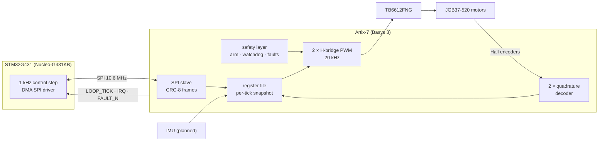

# G4-FPGA-Balance

[](https://github.com/joel0328/G4-FPGA-Balance/actions/workflows/ci.yml)

A motion-control platform for a self-balancing robot, split between an
**STM32G4** and an **Artix-7 FPGA**. The FPGA owns the fast, safety-critical
I/O: motor PWM, encoder decoding, the arming logic and watchdog, and (next)
the IMU. The STM32 runs the 1 kHz control loop and talks to the FPGA over a
CRC-checked SPI register link. Development runs on a Nucleo-G431KB and a
Basys 3; a custom KiCad board comes later.



## Status

Measured on hardware (Nucleo-G431KB + Basys 3, Vivado 2025.1,
STM32CubeProgrammer 2.22.0) unless marked otherwise. Tags mark the gates.

| Milestone | Result |
|---|---|
| **SPI link** (tag `m1-link`) | Bring-up passes at 5.3 and 10.6 MHz SPI. Self-test 10,000 write/readback pairs clean; 73.8k single register accesses/s at 10.6 MHz. 10-minute soak: 45.6M frames, 0 CRC errors. Vivado WNS 3.042 ns / WHS 0.119 ns. Switch/LED, btnC and all IRQ paths confirmed. `.ioc` regenerated in CubeMX 6.17 builds a byte-identical `.bin`. |
| **Burst frames** (map v2) | 176.8k register words/s in 16-word bursts (2.4× single frames); 1.06M frames, 0 CRC errors. Testbench 388 checks; 4 injected RTL bugs all caught. |
| **SPI DMA + 1 kHz control step** | The whole step runs in interrupts: 74–89 µs from tick to done, ~17 µs CPU per step, no SPI in the main loop. 30-minute soak: 1.8M steps, 0 skipped, 0 errors. |
| **Register map generator** | `regs/regmap.toml` generates the Verilog, C, Python and MATLAB constants and the [register table](docs/register-map.md). Regenerating map v3 reproduced all 41 existing C constants exactly; the firmware `.bin` is byte-identical. |
| **[Safety layer](docs/safety.md)** (map v4) | Arming, kick watchdog, latched faults WDT/LINK/ESTOP/ARM_LOST, per-tick snapshot. Testbench 494 checks incl. a per-clock armed-vs-fault invariant; 9 injected RTL bugs all caught. On hardware: each fault cause tripped and cut the outputs; 30-minute armed soak: 1.8M steps, 0 errors, no false trips. Vivado WNS 1.905 ns. |
| **[Motors](docs/motors.md)** (map v5, simulation only) | Two 20 kHz sign-magnitude H-bridge channels gated by ARMED, with a duty clamp, and two x4 quadrature decoders in the snapshot. Testbench 595 checks; 21 injected RTL bugs all caught. Vivado WNS 1.148 ns. Hardware gate in progress: TB6612FNG + JGB37-520. |

CI (GitHub Actions) runs the RTL testbench, the driver↔RTL replay and the
firmware build on every push.

### Roadmap

1. Motors on hardware: spin both ways, measure encoder counts per revolution, 30-minute armed soak.
2. MATLAB tooling: log the per-tick snapshot, identify the motor model.
3. IMU on the FPGA, latched into the snapshot with the encoders.
4. Balancer: two motors on a chassis, a controller designed in MATLAB.
5. Custom board (KiCad) with the G4, the FPGA and the motor drivers.

## Quick start

Hardware: Nucleo-G431KB, Basys 3, jumper wires per [docs/wiring.md](docs/wiring.md).
For motors, also a TB6612FNG module, a JGB37-520 gearmotor and a 12 V supply.

1. **Bitstream:** `vivado -mode batch -nojournal -nolog -source scripts/build_bitstream.tcl`,
   then `... -source scripts/program_fpga.tcl`. The Basys display reads `0000`.
2. **Firmware:** drag `prebuilt/FPGA_Link.bin` onto the **NOD_G431KB** drive,
   or run `python scripts/flash_stm32.py`.
3. **Check:** `python scripts/serial_monitor.py --reset` (needs `pip install pyserial`),
   or open the Nucleo's COM port at 115200 in any terminal and press reset.

Expected: `Init: OK`, clean single-frame and burst self-tests, then once a
second a ticks line (~1000/s, zero CRC errors), a control-step line (one step
per tick, none skipped), a safety line and a motor line. The board never arms
by itself: put **SW15 up** and press **btnC** (re-runs the self-tests, clears
faults, arms) or type `a` in the terminal. Armed, LED15 lights and LEDs 0–13
follow the switches; **btnD is the e-stop**. `m25` + Enter runs motor 1 at
25 %, `s` stops it. The Nucleo's LD2 blinks slowly (fast = FPGA not found,
solid = init error).

## Documentation

| Page | Contents |
|---|---|
| [Wiring](docs/wiring.md) | Pmod JA ↔ Nucleo link, Pmod JB ↔ TB6612FNG and encoders, wiring diagram |
| [Protocol](docs/protocol.md) | SPI frames, CRC, bursts, side-band signals, throughput |
| [Register map](docs/register-map.md) | Every register, generated from `regs/regmap.toml` |
| [Safety layer](docs/safety.md) | Arming, watchdog, faults, snapshot |
| [Motors](docs/motors.md) | PWM, encoders, motor hardware, console commands |
| [Firmware](firmware/FPGA_Link/README.md) | Building and importing the STM32CubeIDE project |

## Repository layout

```
regs/regmap.toml            the register map: the one source for RTL, C, Python, MATLAB, docs
rtl/ constraints/ sim/      FPGA design, Basys 3 pins, testbenches
firmware/FPGA_Link/         STM32CubeIDE project (File > Import > Existing Projects)
prebuilt/                   FPGA_Link.bin/.hex/.elf built from firmware/
scripts/                    Vivado build/program, STM32 flash, serial check, register generator
test/                       builds the STM32 driver on a PC for the replay test
tools/                      generated register constants for PC-side Python and MATLAB
docs/                       documentation and wiring diagrams
Makefile                    make test / make regs / make firmware
```

`make test` (Icarus Verilog + a host C compiler) checks the generated register
files, runs the RTL testbench and replays the real driver's frames against the
RTL. On Windows, run it from Git Bash. `make regs` regenerates the register
files after editing `regs/regmap.toml`; `make firmware` rebuilds `prebuilt/`
(needs arm-none-eabi-gcc).

## License

MIT, see [LICENSE](LICENSE). The vendored ST code under
`firmware/FPGA_Link/Drivers/` keeps its own licenses: STM32G4 HAL is
BSD-3-Clause, CMSIS is Apache-2.0 (see the `LICENSE.md` in each folder).
