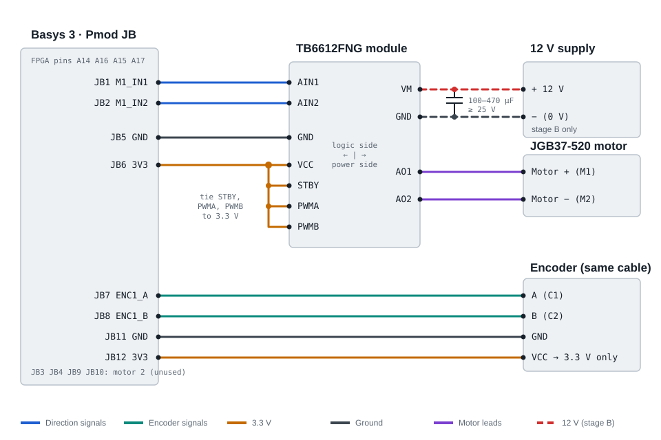

# Wiring

Development hardware: a **Nucleo-G431KB** and a **Basys 3**, each on its own
USB cable. The MCU link uses Pmod JA; motors and encoders use Pmod JB. Pin
assignments are in [`constraints/basys3_link.xdc`](../constraints/basys3_link.xdc),
checked against Digilent's Basys-3-Master.xdc.

## Pmod JA ↔ Nucleo-32 (SPI link)

| Signal | Nucleo | STM32 | Basys 3 | Artix-7 |
|---|---|---|---|---|
| SPI_SCK | D13 | PB3 | JA1 | J1 |
| SPI_MOSI | D11 | PB5 | JA2 | L2 |
| SPI_MISO | D12 | PB4 | JA3 | J2 |
| SPI_CS_N | D10 | PA11 | JA4 | G2 |
| GND | GND (CN4-4) | — | JA5 | — |
| FPGA_IRQ | D2 | PA12 | JA7 | H1 |
| LOOP_TICK | D3 | PB0 | JA8 | K2 |
| FPGA_RST_N | D6 | PB6 | JA9 | H2 |
| FAULT_N | D9 | PA8 | JA10 | G3 |
| GND | GND (CN3-2) | — | JA11 | — |

JA6 and JA12 (VCC) stay unconnected: the two 3.3 V rails are never tied.
Keep the wires short. The second ground next to SCK matters at 10.6 MHz.

## Pmod JB ↔ TB6612FNG and encoders (map v5)

Go by the labels on your TB6612 module and encoder board: pin order varies
between sellers. Wire everything except the 12 V supply first and check the
link and the encoder before connecting it. A 100–470 µF capacitor (≥ 25 V)
across VM and GND at the module absorbs the motor's switching spikes.

| Signal | Basys 3 | Artix-7 | Goes to |
|---|---|---|---|
| M1_IN1 | JB1 | A14 | TB6612 AIN1 |
| M1_IN2 | JB2 | A16 | TB6612 AIN2 |
| M2_IN1 | JB3 | B15 | TB6612 BIN1 |
| M2_IN2 | JB4 | B16 | TB6612 BIN2 |
| GND | JB5 / JB11 | — | TB6612 GND, encoder GND |
| 3.3 V | JB6 / JB12 | — | TB6612 VCC, STBY, PWMA, PWMB; encoder VCC |
| ENC1_A | JB7 | A15 | motor 1 encoder A |
| ENC1_B | JB8 | A17 | motor 1 encoder B |
| ENC2_A | JB9 | C15 | motor 2 encoder A |
| ENC2_B | JB10 | C16 | motor 2 encoder B |

- **Power the encoders from 3.3 V, never 5 V.** Their outputs pull up to the
  encoder supply, and the Artix-7 pins aren't 5 V tolerant.
- **Motor supply:** 12 V into the TB6612's VM (13.5 V maximum), current-limited
  (about 1 A for bring-up). Tie its ground to the Basys ground. Never connect it
  to a Pmod pin.
- With PWMA/PWMB and STBY tied high, the FPGA drives the IN pins. Both low
  means coast, which is the state whenever the board is disarmed. While the
  FPGA is unconfigured, its pull-ups can hold both IN pins high. That is the
  TB6612's short brake, which doesn't drive the motor.
